

## 2026

-----

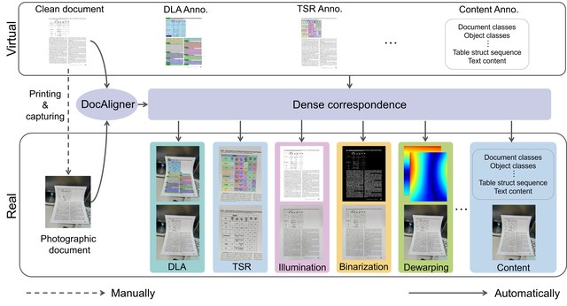

<h3>DocAligner: Automating the Annotation of Photographed Documents through Real-Virtual Alignment</h3>

<strong><u>Jiaxin Zhang</u></strong>, P. Zhang, H. Cheng, X. Chen, H. Xu, K. Ding, L. Jin 
<i>Pattern Recognition</i>, 2026 

-----

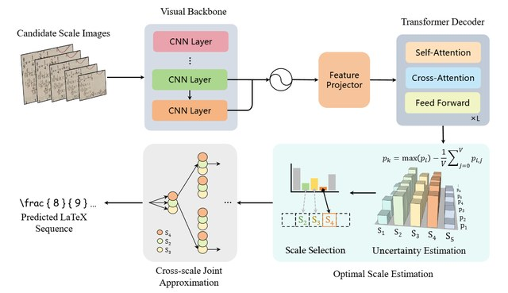

<h3>AutoScaler: Self Scale Alignment for Handwritten Mathematical Expression Recognition</h3>

W. Yang, <strong><u>Jiaxin Zhang</u></strong>, L. Jin 
<i>Pattern Recognition</i>, 2026 

-----

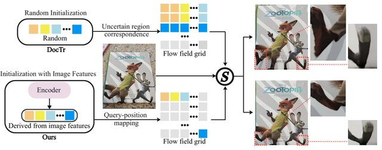

<h3>Q-DRFormer: Query-Position Mapping Flow Prediction with Progressive Refinement for Document Rectification</h3>

J. Li, <strong><u>Jiaxin Zhang</u></strong>, J. Guo, Q. Zhang, X. Zheng, Q. Yin, W. Zeng 
<i>ACM Transactions on Graphics</i>, 46(2), 1–16, 2026 

-----

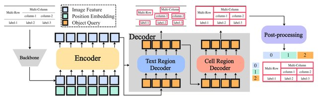

<h3>Text Prior-Guided Cell Alignment with Transformer for Robust Table Structure Recognition</h3>

J. Li, <strong><u>Jiaxin Zhang</u></strong>, Q. Yin, Q. Zhang, X. Zheng, W. Zeng, P. Guo 
<i>Pattern Recognition</i>, 183, 114832, 2026 

## 2025

-----

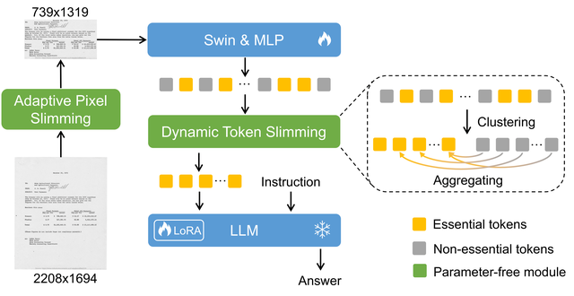

<h3>DocKylin: A Large Multimodal Model for Visual Document Understanding with Efficient Visual Slimming</h3>

<strong><u>Jiaxin Zhang</u></strong>, Wentao Yang, Songxuan Lai, Zecheng Xie, Lianwen Jin* 
AAAI, 2025 

 

-----

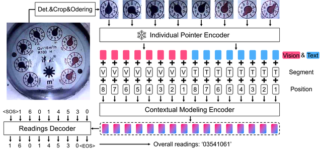

<h3>Towards Accurate Readings of Water Meters by Eliminating Transition Error: New Dataset and Effective Solution</h3>

<strong><u>Jiaxin Zhang</u></strong>, Daizhen Jia, Chongyu Liu, Dezhi Peng, Bangdong Chen, Xue Gao and Lianwen Jin* 
TIM, 2025 

 

-----

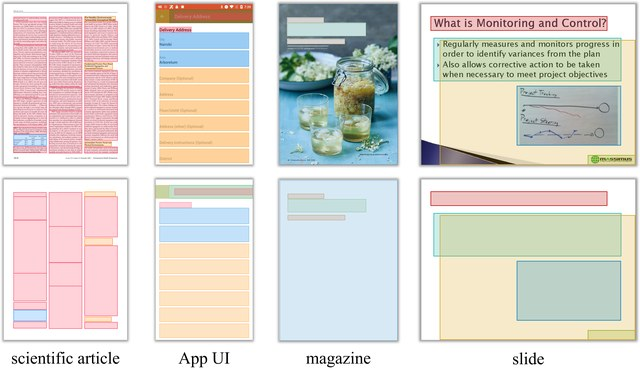

<h3>Smaller but Better: Unifying Layout Generation with Smaller Large Language Models</h3>

P. Zhang, <strong><u>Jiaxin Zhang</u></strong>, J. Cao, H. Li, L. Jin 
<i>International Journal of Computer Vision</i>, 133(7), 3891–3917, 2025 

-----

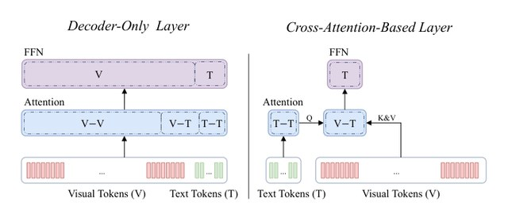

<h3>RedundancyLens: Revealing and Exploiting Visual Token Processing Redundancy for Efficient Decoder-Only MLLMs</h3>

H. Li, <strong><u>Jiaxin Zhang</u></strong>, W. Liao, D. Peng, K. Ding, L. Jin 
<i>Findings of ACL</i>, 2025 

-----
### QT-TextSR: Enhancing Scene Text Image Super-Resolution via Efficient Interaction with Text Recognition

C. Liu, Q. Jiang, D. Peng, Y. Kong, <strong><u>Jiaxin Zhang</u></strong>, L. Xiong, J. Duan, C. Sun, L. Jin 
<i>Neurocomputing</i>, 620, 129241, 2025 

-----

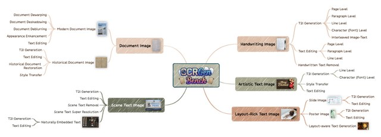

<h3>OCRGenBench: A Comprehensive Benchmark for Evaluating OCR Generative Capabilities</h3>

P. Zhang, H. Xu, <strong><u>Jiaxin Zhang</u></strong>, X. Zheng, G. Xu, Y. Zhang, J. Liu, Z. Yang, W. Zhou, et al. 
<i>arXiv preprint</i> arXiv:2507.15085, 2025 

-----

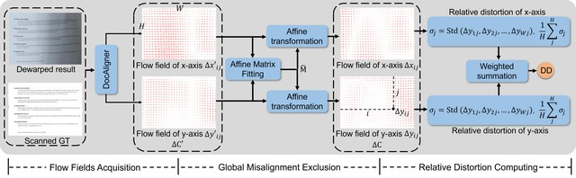

<h3>Enhancing Document Dewarping Evaluation: A New Metric with Improved Accuracy and Efficiency</h3>

<strong><u>Jiaxin Zhang</u></strong>, P. Zhang, D. Peng, H. Xu, L. Jin 
<i>Pattern Recognition Letters</i>, 195, 51–58, 2025 

-----
### Towards Real-World Document Specular Highlight Removal: The DocHighlight Dataset and DocSHRNet Method

H. Xu, <strong><u>Jiaxin Zhang</u></strong>, H. Cheng, P. Zhang, X. Zheng, L. Jin 
<i>PRCV</i>, 109–124, 2025 

## 2024

-----

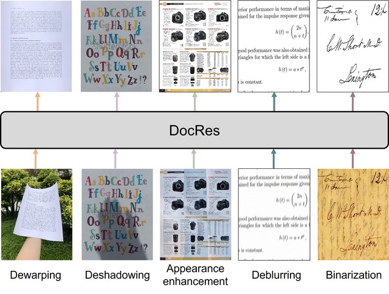

<h3>DocRes: A Generalist Model Toward Unifying Document Image Restoration Tasks</h3>

<strong><u>Jiaxin Zhang</u></strong>, Dezhi Peng, Chongyu Liu, Peirong Zhang, Lianwen Jin* 
CVPR, 2024 

 

-----

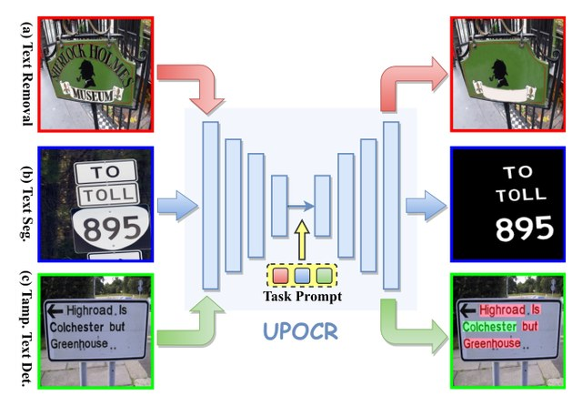

<h3>UPOCR: Towards Unified Pixel-Level OCR Interface</h3>

D. Peng, Z. Yang, <strong><u>Jiaxin Zhang</u></strong>, C. Liu, Y. Shi, K. Ding, F. Guo, L. Jin 
<i>ICML</i>, 2024 

-----

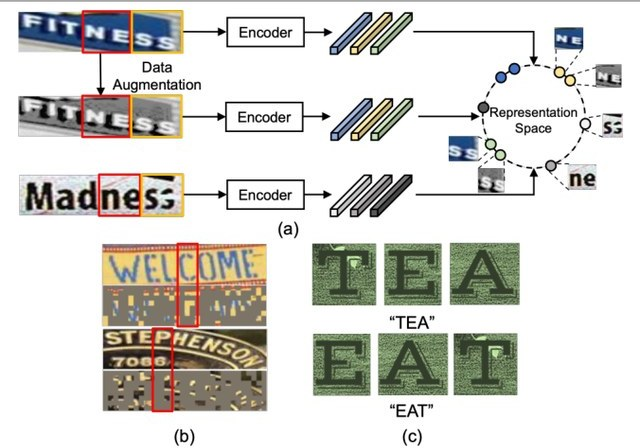

<h3>LEGO: Self-Supervised Representation Learning for Scene Text Images</h3>

Y. Ren, <strong><u>Jiaxin Zhang</u></strong>, L. Jin 
<i>arXiv preprint</i> arXiv:2408.02036, 2024 

## 2023

-----

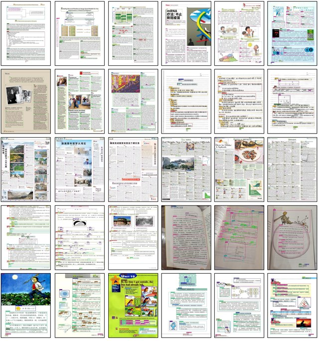

<h3>M6Doc: A Large-Scale Multi-Format, Multi-Type, Multi-Layout, Multi-Language, Multi-Annotation Category Dataset for Modern Document Layout Analysis</h3>

H. Cheng, P. Zhang, S. Wu, <strong><u>Jiaxin Zhang</u></strong>, Q. Zhu, Z. Xie, J. Li, K. Ding, L. Jin 
<i>CVPR</i>, 2023 

-----

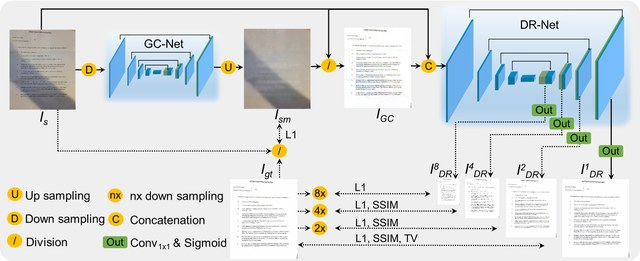

<h3>Appearance Enhancement for Camera-Captured Document Images in the Wild</h3>

<strong><u>Jiaxin Zhang</u></strong>, L. Liang, K. Ding, F. Guo, L. Jin 
<i>IEEE Transactions on Artificial Intelligence</i>, 5(5), 2319–2330, 2023 

-----
### Scene Table Structure Recognition with Segmentation Collaboration and Alignment

H. Wang, Y. Xue, <strong><u>Jiaxin Zhang</u></strong>, L. Jin 
<i>Pattern Recognition Letters</i>, 165, 146–153, 2023 

## 2022

-----

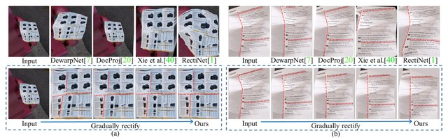

<h3>Marior: Margin Removal and Iterative Content Rectification for Document Dewarping in the Wild</h3>

<strong><u>Jiaxin Zhang</u></strong>, C. Luo, L. Jin, F. Guo, K. Ding 
<i>ACM MM</i>, 2022 

-----

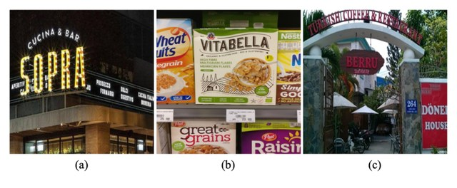

<h3>Looking from a Higher-Level Perspective: Attention and Recognition Enhanced Multi-Scale Scene Text Segmentation</h3>

Y. Ren, <strong><u>Jiaxin Zhang</u></strong>, B. Chen, X. Zhang, L. Jin 
<i>ACCV</i>, 643–659, 2022 

-----
### Complex Table Structure Recognition in the Wild Using Transformer and Identity Matrix-Based Augmentation

B. Chen, D. Peng, <strong><u>Jiaxin Zhang</u></strong>, Y. Ren, L. Jin 
<i>ICFHR</i>, 545–561, 2022 

-----
### Forgery-Free Signature Verification with Stroke-Aware Cycle-Consistent Generative Adversarial Network

J. Jiang, S. Lai, L. Jin, Y. Zhu, <strong><u>Jiaxin Zhang</u></strong>, B. Chen 
<i>Neurocomputing</i>, 507, 345–357, 2022 

-----
### TextSRNet: Scene Text Super-Resolution Based on Contour Prior and Atrous Convolution

J. Ma, L. Jin, <strong><u>Jiaxin Zhang</u></strong>, J. Jiang, Y. Xue, M. He 
<i>ICPR</i>, 3252–3258, 2022 

